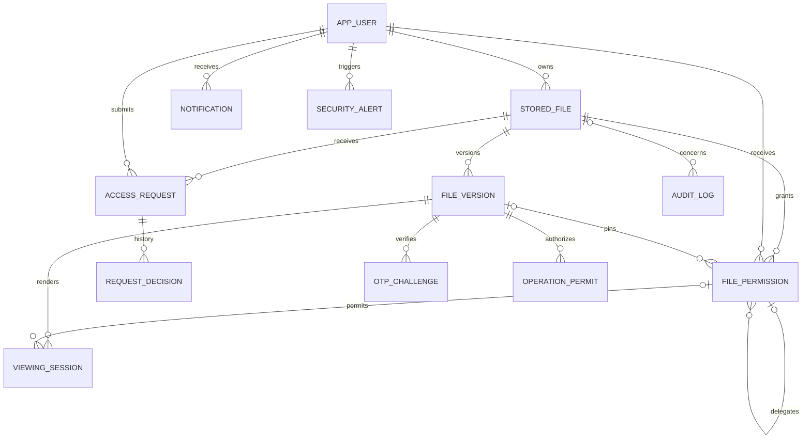
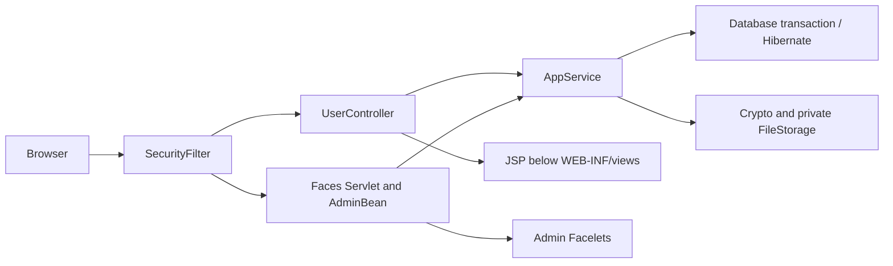
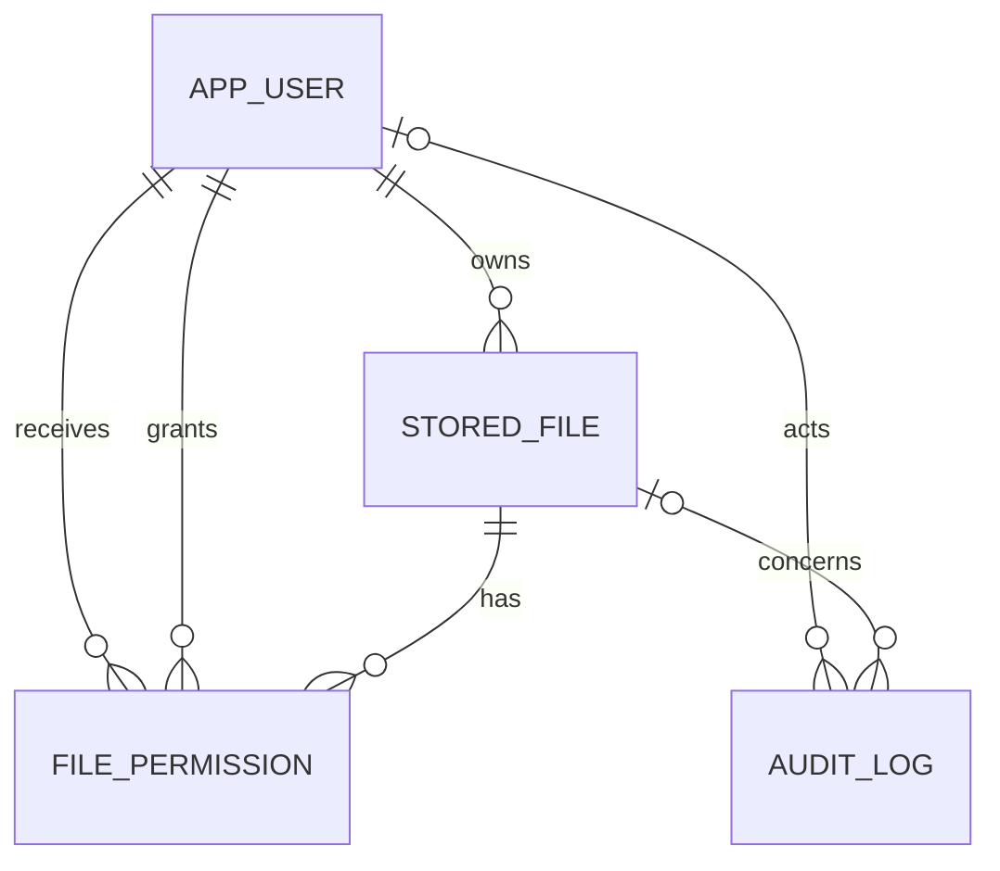

# Advanced architecture update

The current system adds `PermissionEngine` for centralized action/version/grant-chain checks, `AdvancedService` for policy/workflow operations, `AdvancedController` for additional JSP routes, `AuditTrail` for serialized hashes/checkpoints, `OtpDelivery` for SMTP or the explicit local mailbox, and `DocumentRenderer`/`PdfWorker` for bounded in-memory derivatives. Both JSP and Faces call these same services. See [implementation details](advanced-features.md) for consumption, time windows, OTP binding and trust boundaries.

`StoredFile` is now a logical file with immutable `FileVersion` content. Legacy storage/encryption columns are retained to preserve the original schema/data, but advanced content reads use FileVersion. A nullable grant version pin means latest active. Per-user/file uniqueness prevents parallel grants from multiplying allowances. Parent ancestry shares limited budgets. Viewer sessions remain pinned and are checked on every resource request. The audit head is an independent serialization row; checkpoints reside outside Oracle.

The original base architecture below remains useful background; its download-only/no-view/no-reshare boundaries describe the earlier implementation and are superseded by the advanced update.

---

# Architecture and review notes

The application uses MVC. A servlet reads a user's request, the service enforces rules, Hibernate reads or changes the database, and a JSP renders a detached DTO. Admin Facelets pages use a CDI request-scoped bean and call the same service. No view opens a database session.

## Main classes

| Class | Responsibility |
|---|---|
| `AppContext` | Validates environment settings, owns the service and starts periodic cleanup |
| `Database` | Owns one SessionFactory and Hikari connection pool; opens short transactions |
| `AppService` | Validates accounts, enforces permissions, quota and expiry; records audit events |
| `UserController` | HTTP forms, redirects, file transfer and JSP selection |
| `AdminBean` | Request-scoped CDI bridge from Faces actions to services |
| `SecurityFilter` | Authentication, account recheck, role checks, CSRF and response headers |
| `Crypto` | AES-GCM file encryption and authenticated data-key wrapping |
| `FileStorage` | Private disk paths, encrypted temporary writes, deletion and orphan cleanup |
| `UploadValidator` | Restricted filenames, Tika MIME detection and bounded format checks |
| `Passwords` | Argon2id hashing and verification |

Public entity fields keep persistence mappings easy to read; entities never enter the view. DTO maps contain only display values. `Download` holds fully verified plaintext for the short transfer only.

## Request flow

The filter checks the current account on every protected request. The service checks again, so calling it from another controller does not bypass authorization. Admin status permits metadata management; it does not bypass file ownership or recipient checks. All unknown or inaccessible file IDs return the same unavailable message. The download servlet checks access again after decryption and before setting download headers. Revocation affects later requests; an already running or completed download cannot be recalled.

## Encryption

Each upload receives a random 256-bit data key and a fresh 96-bit file IV. AES-GCM authenticates file ciphertext and an AAD string containing the file ID and format version. A separate 256-bit environment master key wraps the data key with another fresh 96-bit IV and a different AAD domain. Oracle stores wrapped keys, both IVs and the format version. It never stores plaintext keys or file contents. The disk stores encrypted bytes with the GCM tag appended.

On download `Cipher.doFinal` authenticates the entire bounded ciphertext before the servlet sees plaintext. A changed tag, changed file ID or wrong master key produces no response plaintext. Plaintext upload/download arrays and temporary key arrays are cleared when possible; Java cannot guarantee removal of every immutable string or internal provider copy. This is server-side encryption, not end-to-end encryption. Anyone controlling the running server and its secrets can decrypt data. Losing the master key makes stored files unrecoverable. Rotation is not implemented: back up the master key separately from the database and encrypted storage.

## Transactions and cleanup

An upload locks its owner's user row before summing active sizes and inserting its file record. Concurrent uploads by that owner serialize, including across application processes sharing Oracle. File mutations lock the file row. Entities use optimistic versions as another defense against stale writes.

The database and filesystem do not share a transaction. Upload writes ciphertext to an owner-only temporary file, moves it to a random storage path, then commits metadata. On failure it checks whether metadata committed before removing the disk file. If that check is uncertain it leaves cleanup to the sweeper. Every minute the sweeper retries physical deletion of tombstoned files and removes unreferenced encrypted files or stale temporary files older than one hour. The delay avoids removing an in-flight upload; transactions are expected to complete well within one hour. Deletion first commits a tombstone and revoked grants; access stops even if disk removal fails. File metadata and audit foreign keys remain. Backups must include both Oracle and storage and preserve a consistent recovery point.

## Sessions and CSRF

Successful login changes the session ID and rotates the synchronizer token. A 20-minute idle limit, HttpOnly cookies, SameSite=Lax, HTTPS Secure configuration and POST logout are provided. Only cookie session tracking is enabled. Failed-login tracking caps entries at 10,000 with a five-minute, five-failure window per email and per remote IP. It is process-local, resets on restart, does not coordinate multiple servers and is not a replacement for production edge rate limits. Proxy headers are not trusted.

Every POST is checked against a random session token, including login, upload, logout, full Faces postbacks and Faces AJAX. Facelets render an ordinary hidden `csrf` input, submitted by `execute="@form"`; the filter rejects requests independently of Faces view state. An expired AJAX session gets a Faces partial-response redirect to login. Faces state remains enabled as an additional framework control. The CSP permits inline script because standard Faces emits inline handlers; no user content is inserted as script or unescaped HTML.

## Data relationships

Emails are normalized with trim and lowercase and are unique. A file/recipient pair has one grant row; re-sharing updates it rather than adding a duplicate. Expiry is valid only while `now < expiresAt`; equality is expired. Clock injection makes this boundary testable. Account disabling and file tombstones preserve relationships and audit history. Ordinary audit rows are not tamper-proof; a database administrator can alter them.

## Deliberate boundaries

There are no public links, inline previews, email delivery, cloud storage or recipient re-sharing. Image decoding is capped at 25 million pixels. PDF validation checks a header and EOF marker; it is not a complete PDF parser. MIME detection and format checks are not malware scanning. Antivirus scanning, key rotation, streaming of larger files, stronger centralized rate limits and independent security review are future work.
